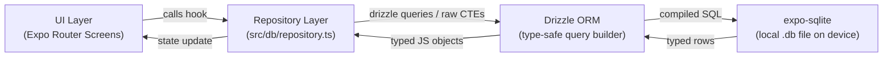

# Second Brain — Life Organizer App: Implementation Plan

> **Status:** Approved Blueprint · Phase 1 (Core Engine) · React Native + Expo (Expo Go Compatible)

---

## 1. Architecture Overview

### Data Flow



### Folder Hierarchy Rules

| Depth | Cosmic Name | Folder Rule |
|-------|-------------|-------------|
| 0 | **Core** | Exactly one node (`parent_id = NULL`), title = "Me". Created on first launch; never deletable. |
| 1 | **Galaxy** | Direct children of Core. Starter templates live here. |
| 2 | **Solar System** | Children of a Galaxy. |
| 3 | **Planet** | Children of a Solar System. |
| 4+ | **Moon / Satellite** | Any depth ≥ 4. `depth` stores the integer so the Phase 2 renderer reads it directly. |

**Key invariant:** `depth` is **always** `parent.depth + 1`. It is computed at insert time and stored (not computed on the fly) so Phase 2's 3D engine can query `SELECT id, depth, title FROM nodes ORDER BY depth` cheaply without recursive CTEs every frame.

### How Phase 1 Prepares Phase 2

| Phase 2 Need | Phase 1 Solution |
|---|---|
| Node size / "mass" | `getDescendantCount(id)` helper reads a pre-computable recursive CTE count. Result can be cached client-side per navigation. |
| Cosmic tier label | `depth` column maps 1-to-1 to tier names; a pure `getTierName(depth)` helper suffices. |
| Color / icon per node | `color` and `icon` columns already in schema; stored and exported. |
| 3D position seed | `created_at` timestamp gives a stable, deterministic orbit seed. |
| Node mass growth | Phase 2 queries `SELECT COUNT(*) FROM nodes WHERE id IN (…recursive subtree…)` — no schema changes needed. |

---

## 2. Complete Project File Tree

```
second-brain/
│
├── src/
│   ├── app/                                 # Expo Router screens (routes live in src/app/)
│   │   ├── _layout.tsx                      # Root layout: DatabaseProvider, dark background
│   │   ├── +not-found.tsx                   # 404 screen
│   │   ├── (tabs)/                          # Bottom tab navigator
│   │   │   ├── _layout.tsx                  # Tab bar config (Explorer, Search, Settings)
│   │   │   ├── index.tsx                    # Explorer tab (drill-down single screen)
│   │   │   ├── search.tsx                   # Global Search tab
│   │   │   └── settings.tsx                 # Settings & Data tab
│   │   └── node/
│   │       ├── _layout.tsx                  # Stack layout for node screens
│   │       └── [nodeId].tsx                 # Entry detail / editor screen
│   │
│   ├── theme/
│   │   └── tokens.ts                        # All color, spacing, typography tokens (StyleSheet only)
│   │
│   ├── db/
│   │   ├── schema.ts                        # Drizzle table definition (source of truth)
│   │   ├── client.ts                        # openDatabaseSync + drizzle() instance
│   │   ├── migrations.ts                    # Re-exports drizzle/migrations barrel
│   │   └── repository.ts                    # All DB query functions (CRUD, CTEs, search)
│   │
│   ├── types/
│   │   └── index.ts                         # All TypeScript interfaces & enums
│   │
│   ├── constants/
│   │   └── starterTemplates.ts              # Seed data for starter categories
│   │
│   ├── components/
│   │   ├── providers/
│   │   │   └── DatabaseProvider.tsx         # useMigrations hook, PRAGMA foreign_keys = ON
│   │   ├── explorer/
│   │   │   ├── Breadcrumb.tsx               # Breadcrumb trail component
│   │   │   ├── NodeCard.tsx                 # Folder or Entry list/grid card
│   │   │   ├── NodeList.tsx                 # FlatList of NodeCards
│   │   │   ├── TierBadge.tsx                # "Galaxy", "Planet" badge chip
│   │   │   ├── AddNodeFAB.tsx               # Floating Action Button + creation modal
│   │   │   └── MoveNodeModal.tsx            # Dedicated destination picker for moving nodes
│   │   ├── detail/
│   │   │   ├── StatusChip.tsx               # Status pill (entry nodes only)
│   │   │   ├── RatingStars.tsx              # 1–10 rating row (entry nodes only)
│   │   │   ├── TagsRow.tsx                  # Horizontal scrollable tag chips (entry nodes only)
│   │   │   └── MetadataEditor.tsx           # Dynamic key-value pair editor (entry nodes only)
│   │   ├── search/
│   │   │   └── SearchResultCard.tsx         # Result with full breadcrumb path
│   │   └── ui/
│   │       ├── ConfirmDialog.tsx            # Reusable confirm/alert dialog (delete, reset)
│   │       ├── TextInputField.tsx           # Themed text input wrapper
│   │       └── EmptyState.tsx               # Empty list placeholder
│   │
│   └── hooks/
│       ├── useNode.ts                       # Single-node fetch + edit
│       ├── useChildren.ts                   # Children of a node (live)
│       ├── useAncestors.ts                  # Breadcrumb ancestor chain
│       ├── useSearch.ts                     # Debounced global search
│       └── useDescendantCount.ts            # Subtree item count ("mass")
│
├── drizzle/                                 # Auto-generated by drizzle-kit
│   ├── 0000_initial.sql
│   └── meta/
│       └── _journal.json
│
├── assets/
│   └── images/
│       └── icon.png
│
├── babel.config.js
├── metro.config.js
├── drizzle.config.ts
├── tsconfig.json
├── app.json
└── package.json
```

---

## 3. Exact Database Schema & TypeScript Interfaces

### 3a. Drizzle Schema — `src/db/schema.ts`

```typescript
import { sqliteTable, text, integer, real } from 'drizzle-orm/sqlite-core';
import { sql } from 'drizzle-orm';

export const nodes = sqliteTable('nodes', {
  // ── Identity ──────────────────────────────────────────────────
  id: text('id').primaryKey(),              // UUID v4 from expo-crypto, generated in app before insert
  parentId: text('parent_id').references(
    () => nodes.id,
    { onDelete: 'cascade' }
  ),                                        // NULL = root "Me" node

  // ── Content ───────────────────────────────────────────────────
  title: text('title').notNull(),
  nodeType: text('node_type', {
    enum: ['folder', 'entry'],
  }).notNull().default('folder'),

  // ── Hierarchy ─────────────────────────────────────────────────
  depth: integer('depth').notNull().default(0),  // 0 = Core, 1 = Galaxy, …

  // ── Visual (Phase 1 stored, Phase 2 rendered) ─────────────────
  icon: text('icon'),                       // emoji or icon string
  color: text('color'),                     // hex string e.g. "#7B61FF"

  // ── Entry Detail Fields (Used on entry nodes) ─────────────────
  status: text('status'),                   // free text: 'completed' | 'liked' | …
  rating: real('rating'),                   // 1.0 – 10.0
  tags: text('tags').default('[]'),         // JSON string: string[]
  metadata: text('metadata').default('{}'), // JSON string: Record<string, unknown>
  notes: text('notes'),                     // long-form plain text in Phase 1

  // ── Description on folders ────────────────────────────────────
  description: text('description'),         // brief one-liner on folder nodes

  // ── Timestamps ────────────────────────────────────────────────
  createdAt: text('created_at')
    .notNull()
    .default(sql`(strftime('%Y-%m-%dT%H:%M:%fZ', 'now'))`),
  updatedAt: text('updated_at')
    .notNull()
    .default(sql`(strftime('%Y-%m-%dT%H:%M:%fZ', 'now'))`),
});

// ── Inferred types (use these everywhere in the app) ──────────────
export type Node    = typeof nodes.$inferSelect;
export type NewNode = typeof nodes.$inferInsert;
```

---

### 3b. TypeScript Interfaces — `src/types/index.ts`

```typescript
// ── Re-export inferred DB types ───────────────────────────────────
export type { Node, NewNode } from '../db/schema';

// ── Enum helpers ─────────────────────────────────────────────────
export type NodeType = 'folder' | 'entry';

export type NodeStatus =
  | 'completed'
  | 'in_progress'
  | 'planned'
  | 'liked'
  | 'disliked'
  | 'neutral'
  | (string & {});

// ── Parsed runtime shapes (tags & metadata already deserialized) ──
export interface ParsedNode extends Omit<Node, 'tags' | 'metadata'> {
  tags: string[];
  metadata: Record<string, unknown>;
}

// ── Breadcrumb ancestor entry ─────────────────────────────────────
export interface BreadcrumbItem {
  id: string;
  title: string;
  depth: number;
}

// ── Search result includes its full ancestor path ─────────────────
export interface SearchResult extends ParsedNode {
  breadcrumb: BreadcrumbItem[];
}

// ── Cosmic tier mapping (used by TierBadge + Phase 2 renderer) ───
export type CosmicTier =
  | 'Core'
  | 'Galaxy'
  | 'Solar System'
  | 'Planet'
  | 'Moon';

// ── JSON export / import shape ────────────────────────────────────
export interface ExportedDatabase {
  version: 1;
  exportedAt: string;      // ISO 8601
  nodes: Node[];           // raw DB rows (tags/metadata as JSON strings)
}

// ── Stats for Settings screen ─────────────────────────────────────
export interface DatabaseStats {
  total: number;
  galaxies: number;
  solarSystems: number;
  planets: number;
  moons: number;
  entries: number;
}
```

---

### 3c. Theme Tokens — `src/theme/tokens.ts`

```typescript
export const Colors = {
  // Background layers
  bg: {
    primary:   '#05060F',  // deep space black
    secondary: '#0D0E1A',  // card surface
    elevated:  '#141628',  // modal / sheet surface
    overlay:   'rgba(5, 6, 15, 0.85)',
  },
  // Accent palette (used for tier badges, tags, FAB)
  accent: {
    core:        '#FFD700',  // gold  — Core / "Me"
    galaxy:      '#7B61FF',  // violet — Galaxy
    solarSystem: '#3FA9F5',  // blue  — Solar System
    planet:      '#4ECDC4',  // teal  — Planet
    moon:        '#A8E6CF',  // mint  — Moon / Satellite
  },
  // Status / semantic
  success:  '#4ECDC4',
  warning:  '#FFD166',
  danger:   '#EF476F',
  // Text
  text: {
    primary:   '#E8EAFF',
    secondary: '#8B8FA8',
    muted:     '#4A4D6B',
  },
  border: '#1E2035',
  star:   '#FFFFFF',  // micro star dots in backgrounds
} as const;

export const Spacing = {
  xs:  4,
  sm:  8,
  md:  16,
  lg:  24,
  xl:  32,
  xxl: 48,
} as const;

export const Radius = {
  sm: 6,
  md: 12,
  lg: 20,
  full: 9999,
} as const;

export const FontSize = {
  xs:  11,
  sm:  13,
  md:  15,
  lg:  18,
  xl:  22,
  xxl: 28,
} as const;

export const FontWeight = {
  regular: '400' as const,
  medium:  '500' as const,
  bold:    '700' as const,
};

// Helper: map depth → accent color
export function tierColor(depth: number): string {
  if (depth === 0) return Colors.accent.core;
  if (depth === 1) return Colors.accent.galaxy;
  if (depth === 2) return Colors.accent.solarSystem;
  if (depth === 3) return Colors.accent.planet;
  return Colors.accent.moon;
}

// Helper: map depth → cosmic tier name
export function getTierName(depth: number): string {
  const tiers = ['Core', 'Galaxy', 'Solar System', 'Planet', 'Moon'];
  return tiers[Math.min(depth, 4)];
}
```

---

### 3d. Repository Layer — `src/db/repository.ts` (Signatures)

```typescript
import type { ParsedNode, SearchResult, DatabaseStats, ExportedDatabase } from '../types';

// ── Root bootstrap ───────────────────────────────────────────────
/** Returns the root "Me" node. Creates it if first launch using Crypto.randomUUID(). */
export async function ensureRootNode(): Promise<ParsedNode>;

// ── CRUD ─────────────────────────────────────────────────────────
/** Fetch a single node by id. Returns null if not found. */
export async function getNode(id: string): Promise<ParsedNode | null>;

/** Fetch all direct children of a node, ordered by nodeType DESC (folders first), then title ASC. */
export async function getChildren(parentId: string): Promise<ParsedNode[]>;

/** Fetch ancestor chain from root to the given node's parent (for breadcrumbs) using recursive CTE + db.all(). */
export async function getAncestors(nodeId: string): Promise<ParsedNode[]>;

/** Insert a new node. Caller provides UUID from expo-crypto. Depth is computed from parent. */
export async function createNode(input: {
  id: string;
  parentId: string;
  title: string;
  nodeType: 'folder' | 'entry';
  icon?: string;
  color?: string;
  description?: string;
}): Promise<ParsedNode>;

/** Partial update — only fields explicitly provided in patch are changed. updatedAt auto-set. */
export async function updateNode(
  id: string,
  patch: Partial<Omit<ParsedNode, 'id' | 'createdAt' | 'updatedAt' | 'parentId' | 'depth'>>
): Promise<ParsedNode>;

/**
 * Move a node to a new parent.
 * Validates: newParentId must not be the node itself or any of its descendants.
 * Updates depth of node AND all descendants recursively inside a transaction.
 */
export async function moveNode(
  nodeId: string,
  newParentId: string
): Promise<ParsedNode>;

/**
 * Delete a node. ON DELETE CASCADE in SQLite handles descendant deletion.
 */
export async function deleteNode(id: string): Promise<void>;

// ── Descendant count (Phase 2 "mass") ────────────────────────────
/** Counts all descendant nodes recursively using recursive CTE + db.all(). */
export async function getDescendantCount(nodeId: string): Promise<number>;

// ── Search ───────────────────────────────────────────────────────
/**
 * Full-text search across title, tags, notes, status using db.all() + ancestor breadcrumbs.
 */
export async function searchNodes(query: string): Promise<SearchResult[]>;

// ── Starter templates ─────────────────────────────────────────────
/** Seeds Galaxy-level starter categories under the root node. Idempotent. */
export async function seedStarterTemplates(rootId: string): Promise<void>;

// ── Stats ─────────────────────────────────────────────────────────
export async function getDatabaseStats(): Promise<DatabaseStats>;

// ── Export / Import ───────────────────────────────────────────────
/** Exports all nodes as a typed JSON object. */
export async function exportDatabase(): Promise<ExportedDatabase>;

/**
 * Replaces the entire database with the provided export.
 * Sorts data.nodes by depth ASC before inserting inside a transaction to satisfy foreign keys.
 */
export async function importDatabase(data: ExportedDatabase): Promise<void>;
```

---

### 3e. Starter Templates — `src/constants/starterTemplates.ts`

```typescript
export interface TemplateDefinition {
  title: string;
  icon: string;
  color: string;
  children?: { title: string; icon: string; color: string }[];
}

export const STARTER_TEMPLATES: TemplateDefinition[] = [
  {
    title: 'Food', icon: '🍜', color: '#FFD166',
    children: [
      { title: 'Liked', icon: '❤️', color: '#EF476F' },
      { title: 'Disliked', icon: '👎', color: '#8B8FA8' },
      { title: 'Want to Try', icon: '⭐', color: '#7B61FF' },
    ],
  },
  {
    title: 'Entertainment', icon: '🎬', color: '#7B61FF',
    children: [
      { title: 'Anime', icon: '⛩️', color: '#3FA9F5' },
      { title: 'Movies', icon: '🎥', color: '#4ECDC4' },
      { title: 'Series', icon: '📺', color: '#A8E6CF' },
      { title: 'Games', icon: '🎮', color: '#FFD700' },
    ],
  },
  {
    title: 'Work', icon: '💼', color: '#3FA9F5',
    children: [
      { title: 'Projects', icon: '📁', color: '#4ECDC4' },
      { title: 'Tasks', icon: '✅', color: '#A8E6CF' },
    ],
  },
  {
    title: 'Study', icon: '📚', color: '#4ECDC4',
    children: [
      { title: 'Notes', icon: '📝', color: '#7B61FF' },
      { title: 'Courses', icon: '🎓', color: '#FFD166' },
    ],
  },
  {
    title: 'Hobbies', icon: '🎨', color: '#A8E6CF' },
];
```

---

## 4. Atomic Execution Roadmap & Git Workflow

### Git Workflow Rules
- Every step is built on its own `feat/<step-name>` branch cut from `dev`.
- Each task within a step is committed in small, atomic commits.
- Verify TypeScript compiles (`npx tsc --noEmit`) and Expo app runs cleanly.
- STOP and request user review and testing in Expo Go before any merge.
- Merging into `dev` happens ONLY after explicit user approval.

---

### Step 1 — Project Scaffold & Tooling Setup
- Configure `tsconfig.json` with `"strict": true` and `"noUncheckedIndexedAccess": true` (do NOT enable `exactOptionalPropertyTypes`).
- Install dependencies:
  - `npx expo install expo-sqlite expo-crypto expo-file-system expo-sharing`
  - `npm install drizzle-orm`
  - `npm install -D drizzle-kit babel-plugin-inline-import`
- Configure Babel: `babel.config.js` with `babel-preset-expo` and `["inline-import", { "extensions": [".sql"] }]`.
- Configure Metro: `metro.config.js` with `'sql'` added to `config.resolver.sourceExts`.
- Configure Drizzle: `drizzle.config.ts` (`schema: './src/db/schema.ts'`, `out: './drizzle'`, `dialect: 'sqlite'`, `driver: 'expo'`).
- Verify `app.json`: name `"Second Brain"`, slug `"second-brain"`, scheme `"second-brain"`.
- Set up clean 3-tab placeholder layout (`src/app/(tabs)/index.tsx`, `search.tsx`, `settings.tsx`, and `_layout.tsx`) using dark-space styling (`#05060F` background, `#E8EAFF` text).
- Remove unused starter routes (`src/app/explore.tsx`) to avoid route collisions.
- **Verification:** `npx tsc --noEmit` passes with 0 errors.

---

### Step 2 — Theme Tokens
- Create `src/theme/tokens.ts` (StyleSheet-compatible colors, spacing, radius, fonts, tier helpers).
- Dark space theme: `#05060F` primary background, `#0D0E1A` card surface, `#141628` elevated surface, `#E8EAFF` text.
- **Verification:** Import `Colors` and type-check without error.

---

### Step 3 — Database Schema & Migration Setup
- Create `src/db/schema.ts` with `nodes` table and self-referencing foreign key `() => nodes.id`.
- Create `src/db/client.ts` with `SQLite.openDatabaseSync('second_brain.db')` and `drizzle(expoDb, { schema })`.
- Run `npm run db:generate` to generate initial migration `drizzle/0000_initial.sql`.
- Create `src/components/providers/DatabaseProvider.tsx` using `useMigrations(db, migrations)` from `drizzle-orm/expo-sqlite/migrator`.
- Run `PRAGMA foreign_keys = ON;` on SQLite initialization so cascade deletes are enforced.
- **Verification:** Database initializes and migrations run successfully on device / Expo Go without errors.

---

### Step 4 — TypeScript Types & Constants
- Create `src/types/index.ts` with `ParsedNode`, `SearchResult`, `BreadcrumbItem`, `CosmicTier`, `ExportedDatabase`, and `DatabaseStats`.
- Create `src/constants/starterTemplates.ts`.
- **Verification:** `npx tsc --noEmit` returns 0 errors.

---

### Step 5 — Repository Layer
- Implement `src/db/repository.ts`.
- **Key Architectural Corrections Applied:**
  1. **UUID Generation:** Use `* as Crypto from 'expo-crypto'` and `Crypto.randomUUID()` (never Node `crypto.randomUUID()`).
  2. **Recursive CTEs for SELECTs:** Never use `db.run()` for `SELECT` queries (`getAncestors`, `getDescendantCount`, `searchNodes`, or subtree queries in `moveNode`). Use `db.all(sql...)` (or `expoDb.getAllSync(...)`).
  3. **Column Aliasing in Raw CTEs:** Explicitly alias all snake_case columns (`SELECT id, parent_id AS parentId, node_type AS nodeType, depth, icon, color, status, rating, tags, metadata, notes, description, created_at AS createdAt, updated_at AS updatedAt`) so `parseNode()` maps every field accurately without undefined keys.
  4. **Circular Move Prevention:** Retrieve the full recursive subtree IDs of `nodeId`. If `newParentId` is in that subtree, reject the move. Update `depth` for the node and all its descendants recursively inside a transaction.
  5. **Import Ordering:** In `importDatabase()`, sort `data.nodes` by `depth ASC` before inserting so parents always exist before children and `PRAGMA foreign_keys = ON` does not reject insertions.
- **Verification:** CRUD, move, ancestor chain, search, and import/export queries execute accurately.

---

### Step 6 — Shared UI Components
- Build shared UI atoms with React Native `StyleSheet`:
  - `src/components/ui/TextInputField.tsx`
  - `src/components/ui/ConfirmDialog.tsx`
  - `src/components/ui/EmptyState.tsx`
  - `src/components/explorer/TierBadge.tsx`
  - `src/components/explorer/Breadcrumb.tsx`
  - `src/components/explorer/NodeCard.tsx`
  - `src/components/explorer/AddNodeFAB.tsx`
  - `src/components/explorer/MoveNodeModal.tsx` — Dedicated modal component for selecting a destination folder when moving a node (cleaner and safer than cramming into `ConfirmDialog`).
  - `src/components/detail/StatusChip.tsx` (entry nodes only)
  - `src/components/detail/RatingStars.tsx` (entry nodes only)
  - `src/components/detail/TagsRow.tsx` (entry nodes only)
  - `src/components/detail/MetadataEditor.tsx` (entry nodes only)
  - `src/components/search/SearchResultCard.tsx`
- **Verification:** Components render with dark-space styles and typed props.

---

### Step 7 — Custom Hooks
- Implement custom data hooks:
  - `src/hooks/useNode.ts`
  - `src/hooks/useChildren.ts`
  - `src/hooks/useAncestors.ts`
  - `src/hooks/useDescendantCount.ts`
  - `src/hooks/useSearch.ts` (with 300ms debounce)
- **Verification:** `npx tsc --noEmit` returns 0 errors.

---

### Step 8 — Explorer Screen (Core Screen)
- Implement `src/app/(tabs)/index.tsx`:
  - Single tab screen managing `currentNodeId` in React state.
  - Drill down by setting `currentNodeId` (no unnecessary route stack push).
  - Android `BackHandler`: if not at root "Me" node, back pops up to `parent.id`.
  - Default view is **List** view (in-memory state).
  - Tapping an entry navigates to `/node/[nodeId]`.
  - Long press triggers actions: Rename, Move (via `MoveNodeModal`), Delete (via `ConfirmDialog`).
  - FAB creates new Folder or Entry.
- **Verification:** Drill down 3+ levels, breadcrumbs update, back navigates up one level, move node works.

---

### Step 9 — Entry Detail & Editor Screen
- Implement `src/app/node/[nodeId].tsx`:
  - Plain `<Text>` for notes in Phase 1 (no complex markdown engine required for Phase 1).
  - Detailed controls (`StatusChip`, `RatingStars`, `TagsRow`, `MetadataEditor`) shown for **entry** nodes only; folders keep minimal metadata.
  - Toggle between View and Edit mode.
  - Header right Delete button with confirmation.
- **Verification:** Edit rating, tags, notes; verify persistence in SQLite.

---

### Step 10 — Global Search Screen
- Implement `src/app/(tabs)/search.tsx`:
  - Search input with debounce.
  - Displays `SearchResultCard` with full breadcrumb path.
  - Tapping entry opens `/node/[nodeId]`; tapping folder navigates Explorer to that folder.
- **Verification:** Search returns results across title, notes, status, and tags with breadcrumbs.

---

### Step 11 — Settings & Data Screen
- Implement `src/app/(tabs)/settings.tsx`:
  - Database stats (total nodes, counts per cosmic tier).
  - One-click "Seed Starter Categories" (idempotent).
  - Export Database to JSON using `expo-file-system` and `expo-sharing`.
  - Import Database from JSON with `depth ASC` insertion.
- **Verification:** Seed templates, export JSON, wipe data, import JSON, confirm restored state.

---

### Step 12 — Polish, Edge Cases & Final QA
- Safeguards:
  - Root node deletion prevention.
  - Circular move prevention.
  - Keyboard avoidance on detail editor (`KeyboardAvoidingView`).
  - Haptic feedback with `expo-haptics`.
- **Verification:** Complete end-to-end user flow testing in Expo Go.

---

### Step 13 — Git Tag & Documentation
- Update `README.md` with dev commands and architecture overview.
- Create git tag `v1.0.0-phase1`.

---

## 5. Edge Cases & Risks Register

### R1 — Circular Parentage on Move
**Risk:** User moves a folder into one of its own descendants, creating an orphan loop.  
**Mitigation:** `moveNode()` executes a recursive CTE querying all descendant IDs of `nodeId`. If `newParentId` is in that set, it throws `Error('Circular move: target is a descendant')` before any write.

---

### R2 — SQLite Foreign Keys & Cascading Deletes
**Risk:** `expo-sqlite` does not enable foreign key enforcement by default; cascade deletes would fail.  
**Mitigation:** In `DatabaseProvider.tsx`, on initial database connection, run `PRAGMA foreign_keys = ON;`. Additionally, `importDatabase()` sorts nodes by `depth ASC` so parent rows exist before children are inserted.

---

### R3 — Drizzle Recursive CTE Support & SELECT Mapping
**Risk:** Drizzle ORM does not natively build `WITH RECURSIVE` queries; `db.run()` does not return row sets.  
**Mitigation:** Never use `db.run()` for `SELECT` queries. Use `db.all(sql...)` (or `expoDb.getAllSync(...)`). Explicitly alias all snake_case columns (`parent_id AS parentId`, `node_type AS nodeType`, `created_at AS createdAt`, `updated_at AS updatedAt`) so `parseNode()` maps properties reliably.

---

### R4 — Migration Execution in Expo Go
**Risk:** Heavy migration tools or native code may break Expo Go compatibility.  
**Mitigation:** Use `useMigrations(db, migrations)` from `drizzle-orm/expo-sqlite/migrator` paired with `babel-plugin-inline-import` and `metro.config.js` (`sourceExts.push('sql')`). This works 100% in Expo Go.

---

### R5 — `depth` Column Drift on `moveNode`
**Risk:** Moving a node without updating its descendants causes tier badge and hierarchy corruption.  
**Mitigation:** `moveNode()` runs inside a database transaction. It computes `newDepth = node.depth - oldDepth + newParent.depth + 1` for each descendant and commits all updates atomically.

---

## 6. Resolved Architectural Decisions

All open architectural questions have been resolved as follows:

1. **Navigation Model for Explorer:**
   - **Decision:** Explorer uses a **single tab screen** with `currentNodeId` in React state and hardware Android `BackHandler` integration. This keeps navigation history clean and avoids URL pollution.
2. **Markdown Support for Notes:**
   - **Decision:** Phase 1 uses plain React Native `<Text>` only. Rich markdown rendering is deferred to Phase 2.
3. **Expo Go Compatibility:**
   - **Decision:** Phase 1 remains **100% compatible with Expo Go**. No mandatory dev build or EAS build required for Phase 1 testing.
4. **List vs. Grid View Default:**
   - **Decision:** Default view is **List view** with in-memory toggle state (no `AsyncStorage` dependency required).
5. **Tags and Metadata on Folders vs. Entries:**
   - **Decision:** Show `tags`, `status`, `rating`, and `metadata` in the UI for **entry** nodes only. Folder nodes remain minimal (displaying icon, title, description, and child count).
6. **Styling & Infrastructure:**
   - **Decision:** No Tailwind CSS / NativeWind (use React Native `StyleSheet` only) and no Docker.
